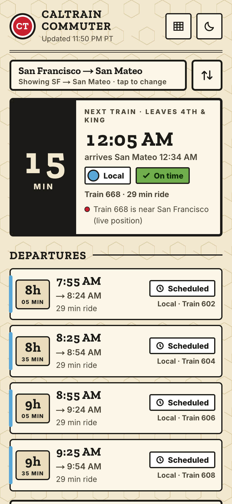
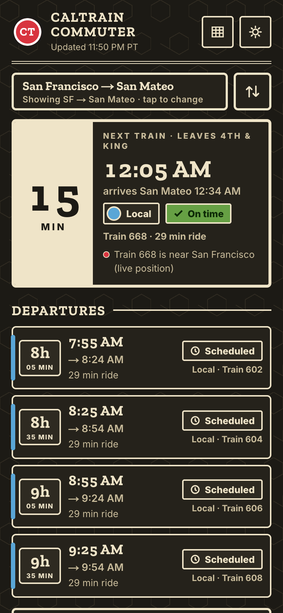
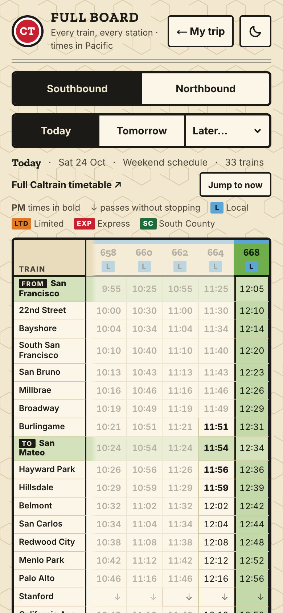
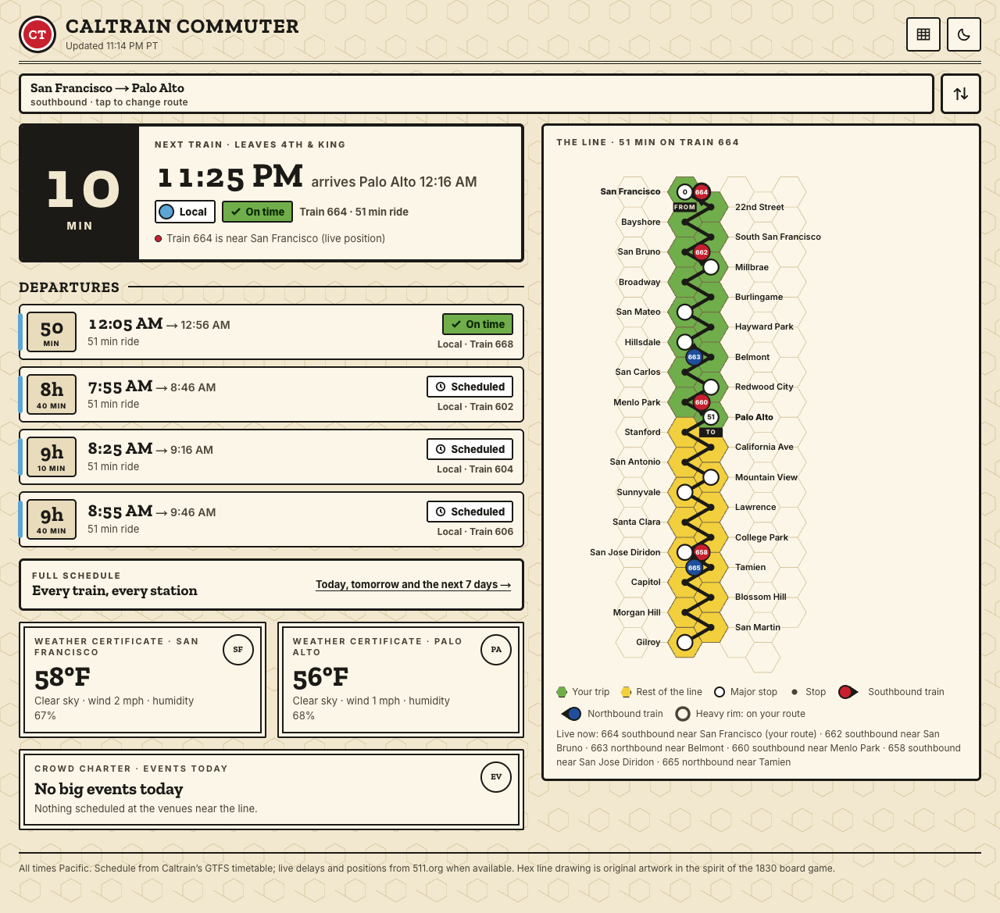
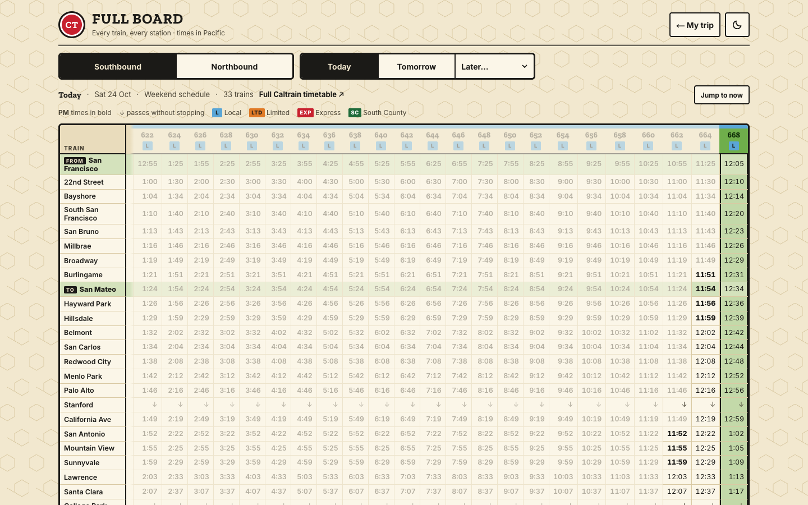
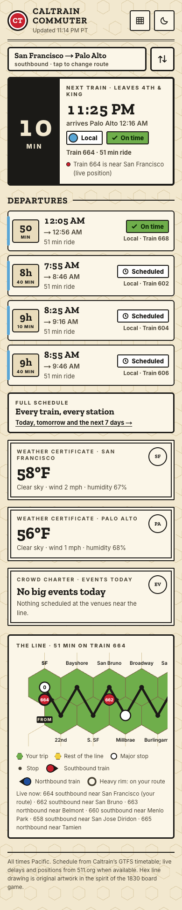

# Caltrain Commuter

A Caltrain commuter board in the style of the **1830** railroad board game.
It answers one question first, *when does my next train leave?*, and keeps
the rest of the trip on the same board: departures, the line with live
trains, the full schedule, weather and nearby events.

Live: <https://caltrain-commuter.vercel.app>

<p>
  
  
  
</p>



## What it shows

- **Next train first.** A black "N MIN" block with the departure time,
  arrival, service type (Local / Limited / Express / South County as flat
  "company charter" colours) and status in tile colours, always with text
  (green on time, yellow late, brown very late, grey cancelled). It fits a
  390 px phone's first screen.
- **Departures.** The next five trains as cards with a minutes-to-go box.
- **The line.** An original hex-tile strip of the whole line, San Francisco
  to Gilroy: your trip in green, the rest in yellow, cities as white circles,
  stops as dots. Every train reporting a position is a token with its real
  number: red southbound, blue northbound, each pointing the way it is going;
  trains on your route have a heavier rim. A text line lists them too.
- **Full board.** The whole timetable for today, tomorrow or any of the next
  seven days: stations down the side, trains across, per direction, with your
  stops and the next train highlighted, PM times in bold and "↓" where a train
  runs through. It says which schedule applies (weekday, weekend, holiday).
- **Weather** for both ends of the trip and **events** near the line (Giants,
  Warriors, Valkyries, 49ers, Sharks, Moscone conventions, concerts), shown as
  double-bordered "certificates".
- **Service alerts** from 511 in one collapsible bar.
- A first visit opens straight on **San Francisco (4th & King) → San Mateo**.
  Once you pick a route it is remembered on the device and kept in the address
  (`?from=sf&to=pa`), so links work; a link beats the remembered route, which
  beats the default. Saved routes live in the route picker.
- A **night board** keeps the 1830 look on a dark table.
- When something is not live (no key, feed down, timetable out of date) one
  quiet note in the header says so; nothing is invented.





## Data sources

| What | Source | Key |
| --- | --- | --- |
| Timetable | 511.org GTFS datafeed for Caltrain (falls back to `data/gtfs`) | `TRANSIT_API_KEY` |
| Delays, cancellations, train positions, alerts | 511.org GTFS-Realtime | `TRANSIT_API_KEY` |
| Weather | OpenWeatherMap current weather | `WEATHER_API_KEY` |
| Concerts and other events | Ticketmaster Discovery API | `TICKETMASTER_API_KEY` |
| Games | ESPN public schedules (Warriors, Valkyries, 49ers), MLB Stats API (Giants), NHL web API (Sharks) | none |
| Conventions | SF Travel (Moscone Center) | none |

Realtime calls are shared: trip updates and vehicle positions are fetched
together once a minute per server and reused by every visitor, well inside
511's default limit of 60 requests an hour. The full board and future days
use the static timetable only.

## Environment variables

Put these in `.env` locally (it is git-ignored) or in your host's settings.
Names only; never commit the values.

| Variable | Where to get it |
| --- | --- |
| `TRANSIT_API_KEY` | <https://511.org/open-data/token> (free) |
| `WEATHER_API_KEY` | <https://openweathermap.org/api> (free tier, "Current weather") |
| `TICKETMASTER_API_KEY` | <https://developer.ticketmaster.com/> (the Consumer Key) |

All three are optional. Without them the board still runs on the committed
timetable and says that live data and the sample weather, alerts and events
are not live.

## Run locally

```bash
npm install
npm run dev        # http://localhost:3000
npm test           # Vitest: stations, timetable, realtime matching, time zones
npm run lint
npm run build
```

Node 20 or newer.

### Refresh the committed timetable

The app reads 511's timetable directly when `TRANSIT_API_KEY` is set. The copy
in `data/gtfs` is the fallback for running without a key; refresh it when the
board's note says the timetable has passed its end date:

```bash
node --env-file=.env scripts/update-gtfs.mjs
```

### Icons and share image

`app/icon.svg`, `app/favicon.ico`, `app/apple-icon.png` and
`public/og-image.png` are generated:

```bash
npm i --no-save puppeteer-core
node scripts/brand/make.mjs
```

## Deploy on Vercel (Hobby plan)

1. Import the GitHub repository at <https://vercel.com/new>.
2. Keep the detected Next.js settings.
3. Add `TRANSIT_API_KEY`, `WEATHER_API_KEY` and `TICKETMASTER_API_KEY`
   under Settings → Environment Variables.
4. Deploy. The project is served at <https://caltrain-commuter.vercel.app>.

## Design

The look borrows the spirit of the 1830 board game: cream paper with a faint
hex pattern, heavy black rules, slab-serif numerals, flat tile colours and
round railroad tokens. Every drawing here (the hex strip, the tokens, the "CT"
mark, the share image) is original; no game artwork, map, or real railroad
marks are used. Fonts are Zilla Slab and Inter via `next/font`.

## Project layout

```
app/                 page, full board (/board), API routes, icons
  api/trains         next trains + live status + live trains (one request)
  api/board          the whole line's timetable for a date
  api/alerts, api/weather, api/events
components/          board UI (CommuterBoard, LineStrip, FullBoard, …)
lib/                 GTFS static + realtime, stations, Pacific time, schedules
data/gtfs/           committed fallback timetable from 511
scripts/             timetable refresh, brand image generator, Moscone helpers
tests/               Vitest suites
```

## History

The app first ran on Railway with an observability demo setup. It now
targets Vercel. The Chrome-based scrapers (caltrain.com alerts,
SimplifyTransit, Twitter) and the simulated delays are gone: live data comes
from 511 only, and when it is missing the board shows the timetable as
scheduled and says so.

## License

ISC
